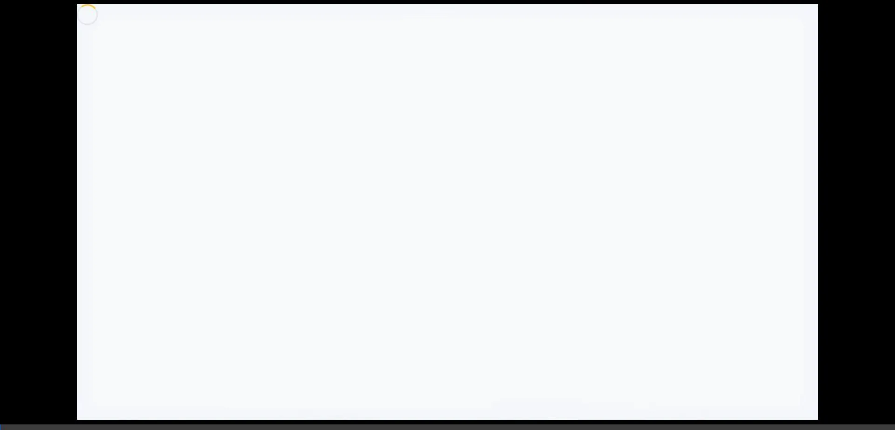

# 🏗️ BuildConnect — Direct Construction Workforce & Project Platform

> **Skilled People | Trusted Projects | Stronger Tomorrow**  
> BuildConnect is a modern, full-stack workforce SaaS platform that bridges the gap between skilled construction tradesmen, commercial contractors, real estate builders, and domestic homeowners.

---

## 🎬 Platform Demonstration



*Interactive preview of the BuildConnect platform, showing responsive dashboards, public landing experience, and role-based portals.*

> 📹 **Extended High-Definition Walkthrough**: View the full multi-portal walkthrough video in [`./docs/full-verification-tour.webp`](./docs/full-verification-tour.webp).

---

## 🌟 Key Platform Portals

BuildConnect is structured into four distinct, role-based workflows:

### 1. 👷 Skilled Worker Portal (`/worker/*`)
- **Dashboard & Job Feed**: Search jobs by title/location, filter by trades, employer type, and proximity (5 km, 15 km, 25 km, 50 km).
- **Interactive Proposal Modal**: Review job specs, requirements (`Experience`, `Own Tools`, `ID Proof`), employer ratings, and submit solo or squad bids.
- **My Active Gigs**: Segmented tabs for *Pending Applications*, *Hired & Active*, and *Completed* contracts.
- **Squad / Team Management**: Form or join organized trade squads, manage rosters, share invitation codes, and review join requests.
- **Worker Profile & Portfolio**: Live availability switch, daily wage expectations, skill tags, and construction project photo gallery.

### 2. 🏗️ Commercial Contractor Portal (`/contractor/*`)
- **Executive Dashboard**: Real-time metrics for *Active Requests*, *Deployed Workers*, and *Open Tenders*.
- **Post Labor Request**: 4-step wizard (`Details` → `Requirements` → `Location` → `Review`) supporting Solo, Squad, or Both hiring modes with urgency tags (`Normal`, `Urgent`, `ASAP`).
- **Applicant Review**: Filter by trade and request; status pipeline (`All`, `Pending`, `Hired`, `Shortlisted`, `Rejected`) with 1-click **Shortlist**, **Hire**, or **Decline**.
- **Builder Tender Feed**: Browse high-value infrastructure projects posted by verified builders and submit technical bids.
- **Active Job Sites**: Track on-site personnel and squad rosters across civil locations.

### 3. 🏛️ Real Estate Builder Portal (`/builder/*`)
- **Project Overview Dashboard**: Track total active projects, open tenders, and cumulative budget allocations (`₹ Cr`).
- **Publish Project / Tender**: Dual-channel workflow:
  - **A. Commercial Tender**: Multi-phase technical tenders for general contractors.
  - **B. Direct Labor**: Large-capacity trade squads on daily or milestone rates.
- **Tender Bids Review**: Compare incoming contractor bids, ratings, and award contracts with confirmation safeguards.
- **Project Tracker & Oversight**: 5-stage milestone tracker (`Planning` → `Bidding` → `Construction` → `Finishing` → `Handover`) and workforce deployment quotas (Masons, Electricians, Helpers).

### 4. 🏠 Domestic Client / Homeowner Portal (`/domestic/*`)
- **Homeowner Dashboard**: 10 quick-service repair categories (*Plumbing, Electrical, AC Repair, Carpentry, Painting, Cleaning, Pest Control, Appliance, Handyman, More*).
- **Book Micro-Job**: Transparent visit fee booking with urgency levels (`Today`, `Tomorrow`, `Weekend`, `Flexible`).
- **Nearby Specialist Matching**: Geolocation proximity matching (`Nearby Specialists` vs `Incoming Bids`) with direct call actions.
- **Job Completion & Payment**: Interactive 5-star rating, written feedback, itemized invoices, payment method selection (`Cash`, `UPI`, `Card`), and instant digital receipts.

---

## 🎨 Visual Design System

The application follows the design guidelines of modern industrial workforce software:

| Design Token | Value | Purpose |
|---|---|---|
| **Deep Charcoal** | `#101820` | Persistent sidebar, public header, branding headers |
| **Construction Yellow** | `#FFC629` | Primary CTA buttons, active navigation pills, progress highlights |
| **Pure White** | `#FFFFFF` | Elevated cards, forms, modals |
| **Soft Page BG** | `#F7F8FA` | Neutral canvas background |
| **Border Light** | `#E5E7EB` | Subtle card outlines and divider rules |
| **Success Green** | `#16845B` | Verified badges, hired statuses, payment confirmations |
| **Typography** | `Poppins`, `Inter` | Clean sans-serif hierarchy from Google Fonts |

---

## 🛠️ Technology Stack

- **Frontend**: React.js with JSX, React Router v6
- **Styling**: Vanilla CSS with centralized design tokens (`index.css`)
- **Build Tool**: Vite
- **Backend**: Node.js, Express.js
- **Database**: MongoDB with Mongoose ODM
- **Authentication**: JWT (JSON Web Tokens) with Role-Based Access Control (RBAC)

---

## 📂 Project Structure

```text
BuildConnect/
├── client/                     # Frontend (React + Vite)
│   ├── public/                 # Static assets and icons
│   ├── src/
│   │   ├── components/
│   │   │   ├── layout/         # Navbar, Sidebar, PortalTopBar
│   │   │   └── routing/        # ProtectedRoute, PublicOnlyRoute
│   │   ├── context/            # AuthContext (JWT session management)
│   │   ├── pages/
│   │   │   ├── auth/           # Login & Signup with role selector
│   │   │   ├── builder/        # Builder portal pages
│   │   │   ├── contractor/     # Contractor portal pages
│   │   │   ├── domestic/       # Homeowner portal pages
│   │   │   ├── worker/         # Worker portal pages
│   │   │   ├── AboutPage.jsx   # About Us & How It Works
│   │   │   └── LandingPage.jsx # Public marketing landing page
│   │   ├── utils/              # Axios API instance and endpoints
│   │   ├── App.jsx             # Master route definitions
│   │   ├── index.css           # Design tokens, component utilities
│   │   └── main.jsx            # React root mount
│   ├── package.json
│   └── vite.config.js
│
├── server/                     # Backend (Node.js + Express + MongoDB)
│   ├── src/
│   │   ├── controllers/        # Route controllers
│   │   ├── middleware/         # Auth JWT, RBAC authorization, error handlers
│   │   ├── models/             # Mongoose schemas (User, Job, Team)
│   │   └── routes/             # Express route routers
│   ├── .env.example            # Environment variable template
│   ├── index.js                # Express app entry point & MongoDB connection
│   └── package.json
│
├── docs/                       # Walkthrough recordings & visual assets
│   ├── demo-walkthrough.webp
│   └── full-verification-tour.webp
│
├── .gitignore                  # Git ignore rules for node_modules, .env, dist
└── README.md                   # Project documentation
```

---

## 🚀 Getting Started Locally

### Prerequisites
- [Node.js](https://nodejs.org/) (v18 or higher recommended)
- [MongoDB](https://www.mongodb.com/) (Local instance or MongoDB Atlas cluster connection string)
- [Git](https://git-scm.com/)

### 1. Clone the Repository
```bash
git clone https://github.com/gourang-22/Build-Connect.git
cd Build-Connect
```

### 2. Configure Backend Environment
Navigate to the `server/` folder and create a `.env` file from the example:
```bash
cd server
cp .env.example .env
```

Open `server/.env` and configure your credentials:
```env
PORT=5000
MONGO_URI=mongodb+srv://<username>:<password>@cluster.mongodb.net/buildconnect?retryWrites=true&w=majority
JWT_SECRET=your_super_secret_jwt_key_here
JWT_EXPIRE=30d
NODE_ENV=development
```

Install backend dependencies and start the server:
```bash
npm install
npm run dev
# Server runs on http://localhost:5000
```

### 3. Configure and Start Frontend
Open a new terminal window, navigate to the `client/` folder:
```bash
cd client
npm install
npm run dev
# Client runs on http://localhost:3000
```

Open your browser and visit: `http://localhost:3000`

---

## 👥 Team Collaboration Workflow (Working Together on GitHub)

Follow these steps so team members can contribute without merge conflicts:

### Step 1: Add Collaborators on GitHub
1. The repository owner goes to: `https://github.com/gourang-22/Build-Connect/settings/access`
2. Click **"Add people"**.
3. Enter your colleague's GitHub username or email address and click **"Add to this repository"**.
4. Your colleague will receive an invitation email and must accept it at `https://github.com/gourang-22/Build-Connect/invitations`.

### Step 2: Colleague Clones and Sets Up
Once the invitation is accepted, your colleague runs:
```bash
git clone https://github.com/gourang-22/Build-Connect.git
cd Build-Connect

# Setup server
cd server
npm install
# Create server/.env with valid MONGO_URI and JWT_SECRET

# Setup client
cd ../client
npm install
```

### Step 3: Best Practice Git Feature Branch Workflow
To prevent overwriting each other's work, always work on dedicated feature branches:

1. **Before starting any new task, update your local `main` branch:**
   ```bash
   git checkout main
   git pull origin main
   ```

2. **Create a new branch for your feature:**
   ```bash
   git checkout -b feature/contractor-tender-filter
   ```

3. **Make your code edits, test them, and stage/commit:**
   ```bash
   git add .
   git commit -m "feat: add category filter to contractor tender feed"
   ```

4. **Push your branch to GitHub:**
   ```bash
   git push -u origin feature/contractor-tender-filter
   ```

5. **Open a Pull Request (PR) on GitHub:**
   - Go to `https://github.com/gourang-22/Build-Connect/pulls`
   - Click **"New Pull Request"**
   - Review changes with your colleague and click **"Merge Pull Request"**
   - Both members can then run `git checkout main && git pull origin main` to stay synchronized.

---

## 📄 License
This project is licensed under the MIT License.
